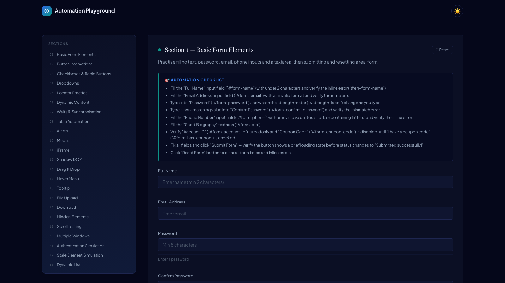
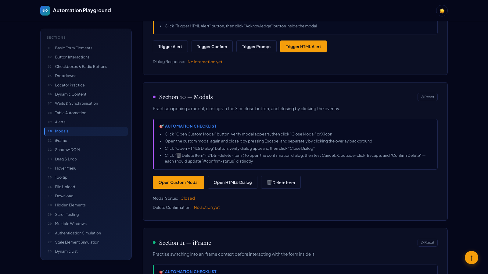
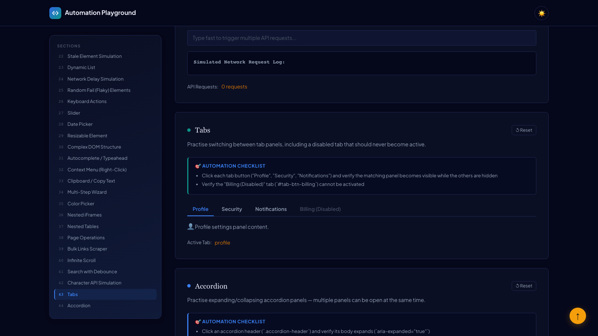

<div align="center" markdown="1">

# 🎯 Automation Playground

### A free, open-source sandbox for practicing UI test automation


### 🌐 [Try it live →](https://ghanendra-sdet.github.io/automation-playground/)

</div>

---

## What This Is

52 self-contained challenge sections — real forms, tables, alerts, modals, iframes, shadow DOM,
drag & drop, flaky/randomized elements, dynamic lists, debounced search, tabs, accordions, a
rich text editor, an interactive tree view, cascading dropdowns, OTP inputs, toasts, and more —
built specifically to be pointed at with Playwright, Selenium, Cypress, or Robot Framework. Every
interactive element carries an `id`, `data-testid`, and `aria-label`, so you can practice every
locator strategy on one page instead of hunting across the internet for a site that has the one
specific UI pattern you're trying to learn.

Built with **Vite + TypeScript**, includes a dark/light theme toggle, and ships with a real
**Playwright test suite** you can read, run, and extend.

## Preview

<p align="center">
  
</p>
<p align="center">
  
</p>
<p align="center">
  
</p>

## Sections

```
01. Basic Form Elements          19. Scroll Testing                37. Nested Tables
02. Button Interactions          20. Multiple Windows              38. Page Operations
03. Checkboxes & Radio Buttons   21. Authentication Simulation     39. Bulk Links Scraper
04. Dropdowns                    22. Stale Element Simulation      40. Infinite Scroll
05. Locator Practice             23. Dynamic List                  41. Search with Debounce
06. Dynamic Content              24. Network Delay Simulation      42. Character API Simulation
07. Waits & Synchronisation      25. Random Fail (Flaky) Elements  43. Tabs
08. Table Automation             26. Keyboard Actions              44. Accordion
09. Alerts                       27. Slider                        45. Toggle / Switch
10. Modals                       28. Date Picker                   46. Toast Notifications
11. iFrame                       29. Resizable Element             47. Dependent Dropdowns
12. Shadow DOM                   30. Complex DOM Structure         48. OTP / Verification Code
13. Drag & Drop                  31. Autocomplete / Typeahead      49. Rich Text Editor
14. Hover Menu                   32. Context Menu (Right-Click)    50. Tree View
15. Tooltip                      33. Clipboard / Copy to Clipboard 51. Responsive Navigation
16. File Upload                  34. Multi-Step Wizard / Stepper   52. Popover
17. Download                     35. Color Picker
18. Hidden Elements              36. Nested iFrames
```

Several existing sections were also deepened rather than duplicated: **Basic Form Elements** now
has live inline validation, a password-strength meter, and readonly/disabled/conditionally-enabled
fields; **Table Automation** now has bulk row selection with an indeterminate select-all, inline
cell editing, numbered pagination, and a skeleton-loading reload state; **Modals** now includes a
genuine confirm/cancel destructive-action dialog plus Escape-key support; **Date Picker** now
disables past/out-of-range dates and pairs with a time input.

## Running Locally

```bash
npm install
npm run dev        # starts the dev server (Vite prints the local URL)
```

## Running the Tests

```bash
npx playwright test              # headless
npx playwright test --headed     # watch it happen in a real browser
npx playwright show-report       # view the HTML report after a run
```

> [!NOTE]
> The included test suite (`tests/practice.spec.ts`) currently covers a subset of the 52 sections
> as worked examples — Basic Form Elements, Button Interactions, and others. It's meant as a
> starting point to extend, not a claim that every section is pre-tested. Contributions adding
> coverage for more sections are welcome.

## Tech Stack

| Category | Tool |
|---|---|
| Build tool | Vite |
| Language | TypeScript |
| Testing | Playwright |
| Hosting | GitHub Pages |

## Contributing

Found a bug, want to add a new challenge section, or add test coverage for an existing one? Fork
it, branch, and open a PR — see the section list above for gaps.

## License

MIT — see [LICENSE](LICENSE).
